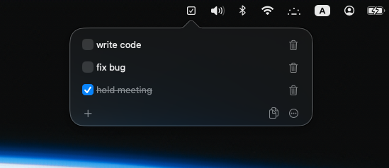

# doohickey

A small native style macOS menu bar checklist.

- **+** to add a task
- [x] to check/uncheck a task
- **trash icon** to delete a task
- **copy icon** to copy the whole list as a Markdown checklist

## Shortcuts

| Shortcut | Action |
| --- | --- |
| **Shift + Enter** | Save the current edit and start a blank task at the bottom. |
| **↑ / ↓** | Save the current edit and move the text cursor to the previous or next task. |
| **Enter** | Save the current edit and check or uncheck the current task. |
| **Shift + Forward Delete (⌦)** | Delete the current row. On a MacBook, press **Shift + Fn + ⌫**. The cursor moves to the next task, or to the previous task at the end of the list. |
| **Escape** | Cancel the current edit. |

Edits also save when you leave the row or close the popover. Empty drafts are discarded.

## Run

To build and run the app, you need Rust 1.89 or later and the Xcode Command Line Tools installed.
Run 

On macOS 14 or later, with Rust 1.89 or later and the Xcode Command Line Tools installed, run `cargo run --release`.

Run `just install` to build and install the app in `~/Applications/doohickey.app`. Launch it with `open ~/Applications/doohickey.app`. Choose **Quit doohickey** from the popover’s **…** menu to exit.

Run `just startup` to install doohickey and add it to your macOS login items.

Tasks are saved locally in `~/Library/Application Support/doohickey/tasks.json`.
